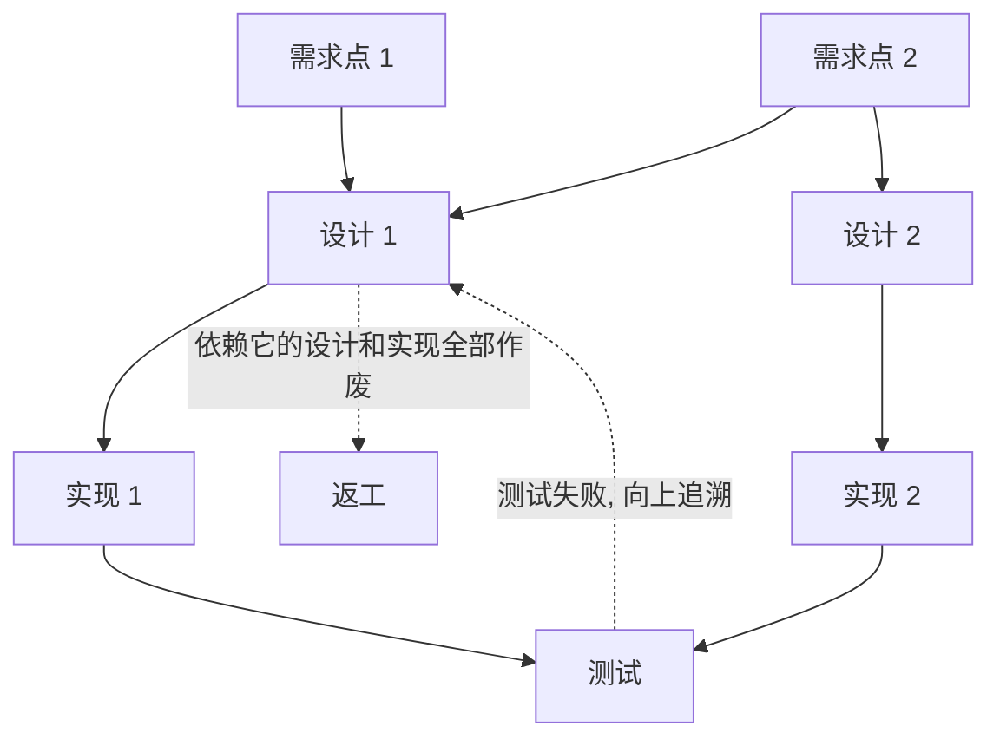
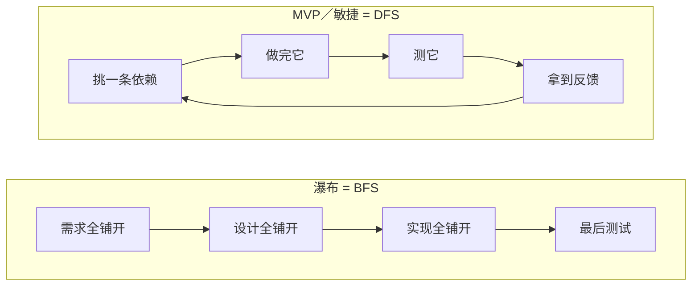
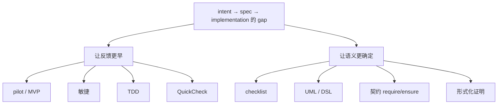

# 5 软件工程的来龙去脉：弥合意图与实现的 gap

## 我的理解

- first principle：把问题拆到最基本、不可再简化的事实，再从这些事实推导解决方案。
- 软件工程要解决的是 intent、spec、implementation 之间的 gap。
- 历史上的方法，如瀑布、DAG 视角下的 BFS 与 DFS、形式化语言、UML，要放到 AI 时代重新看定义和取舍：哪些保留，哪些更替。UML 已经死了，至少我现在不会用。

## 核心观点

### 软件就是三层之间的 gap

- intent：想要什么。
- spec：架构、接口、约束。
- implementation：真正跑起来的代码。

软件需求是人拍脑袋想出来的，连提需求的人都没想好 corner case。比如选课系统要求先修课，这是硬约束还是软约束？谁能特批？到毕业前就差这门课时，学校往往会开口子。

> 生图提示词：横向信息图，16:9，白色背景，扁平矢量风格，低饱和蓝灰配色，橙色作强调色。从左到右三个圆角卡片，依次写「intent 想要什么」「spec 架构、接口、约束」「implementation 跑起来的代码」。卡片之间不用箭头，而是各有一道明显的裂缝，裂缝处用橙色标「gap」。画面简洁，留白多，中文清晰可读。

### 三条 first principle

- **测试前程序不能运行**：设计阶段只有报告，没有强约束，漂移要到测试才暴露。例子：刷 OJ 时先想了个错的算法就开写，写完跑样例才发现整个算法是错的。
- **不会发生的事也会发生**：Hamilton 默认任何假设都可能被违反。阿波罗 11 号下降时报警，软件靠优先级和恢复机制，让下降控制继续运行。
- **每一步翻译都会出错**：从 spec 到代码会出错，不 crash、不泄露资源这类隐含的 spec 也会漏。例子：Eiffel 的取款函数，写前置条件时才会想到余额不足该怎么办。

### 瀑布贵在依赖会传递

Royce 1970 年的论文提出瀑布，是为了批判它。把需求、设计、实现之间的关联画成 DAG，测试失败就要往上追溯，依赖错误设计的实现全部作废，所以发现得越晚，代价越大。

> 生图提示词：竖向信息图，4:3，白色背景，扁平矢量风格，低饱和蓝灰配色，橙色和红色作强调色。从上到下四层圆角节点：第一层「需求点 1」「需求点 2」，第二层「设计 1」「设计 2」，第三层「实现 1」「实现 2」，最底层一个「测试」。用细箭头表示依赖：需求点 1 和需求点 2 都指向设计 1，需求点 2 还指向设计 2；设计 1 指向实现 1，设计 2 指向实现 2；两个实现都指向测试。测试节点上打一个红色叉，一条红色虚线从测试往上回溯到设计 1。设计 1 和实现 1 变成灰色并带裂纹，表示作废，旁边小字「依赖它的全部返工」。中文清晰可读。

- 瀑布是 BFS：一层铺满再做下一层，最后才测试。
- MVP 和敏捷是 DFS：先走通优先级最高的一条依赖，每一步都拿到反馈。
- Do it twice：先做一个会扔掉的 pilot。扔掉的是代码；需求要修正，意图不变。当年代码贵，最多做两遍；现在代码便宜，可以做很多遍。

> 生图提示词：左右对比信息图，16:9，白色背景，扁平矢量风格，低饱和蓝灰配色，橙色作强调色。两边都是同样的四层网格，从上到下依次是「需求」「设计」「实现」「测试」。左半边标题「瀑布 = BFS」，四层横向色带逐层铺满整个宽度，最底层的测试处画一个爆炸符号，标「风险最后爆发」。右半边标题「MVP／敏捷 = DFS」，只有一条竖向窄通道从需求一路贯通到测试，用橙色高亮，旁边画一个循环箭头，标「走通一条就拿反馈」，其余格子是浅色虚线框，表示待做。中文清晰可读。

### 历史上的方法是两条线

- **让反馈更早**：pilot、MVP、敏捷、TDD、QuickCheck（写性质，自动生成用例找反例）。
- **让语义更确定**：自然语言 → checklist → UML 和 DSL → 编程语言加契约 → 形式化证明（Dafny、Verus）。

> 生图提示词：分叉信息图，16:9，白色背景，扁平矢量风格，低饱和蓝灰配色，橙色作强调色。顶部一个橙色标签「intent → spec → implementation 的 gap」，向下分成左右两条路。左路标题「让反馈更早」，画成一条向前延伸的时间轴，沿途依次放图标和文字：草稿纸「pilot / MVP」、循环箭头「敏捷」、打勾的测试单「TDD」、骰子「QuickCheck」。右路标题「让语义更确定」，画成逐级升高的台阶，从低到高依次是：对话气泡「自然语言」、勾选清单「checklist」、类图方框「UML / DSL」、带锁的代码块「契约 require / ensure」、数学符号「形式化证明」。台阶越高颜色越深，表示越形式化。中文清晰可读。

另外，traceability 把依赖图显式建出来，防御性编程默认前提会被违反。遇到新工具，可以先问：它是让反馈更早，还是让语义更确定？

### AI 时代：保留与更替

讲师的判断：LLM 解决了人和人对不齐、checklist 难检查的问题，剩下的只有「我没想清楚、没说清楚」。

| 方法 | 原来解决什么 | AI 时代 |
|---|---|---|
| UML 等中间语言 | 写代码前让人和人对齐 | 不再需要，AI 能直接在自然语言和代码之间翻译 |
| 人工 checklist | 防遗漏 | 检查交给 AI，跟客户确认这一项仍要人做 |
| MVP、do it twice | 早拿反馈 | 更重要，也更便宜 |
| TDD、契约、断言 | 定义什么算对 | 更重要：AI 写实现，人定验收 |
| traceability | 找到依赖 | 更重要：AI 改得快，漂移也快 |
| 任务划分 | 分工 | 不变：leader 要先划分任务，不能让团队自己组织 |

从 spec 到实现这一步几乎免费了，intent 到 spec、以及怎么验证，这两头更值钱。AI 也会让 BFS 变得便宜，一次铺出整套系统，但 intent 错了照样全部作废，所以 DFS 要靠人坚持。

### AI 漂移快怎么办

AI 改代码很快，文档和测试跟不上。解法是把 spec 和验收当源头，代码随时可以重新生成：

- 验收写成测试和断言，漂移在跑测试时自动暴露，不靠人读文档发现。
- 改代码时，在同一次提交里同步改文档和测试，写进 `AGENTS.md` 作为规则。
- 小步提交，每步都跑测试，漂移只发生在一小步里。
- 让 Agent 定期对照文档和代码，报出对不上的地方，思路同第 4 讲的 repo.db。

来源：[生成式软件工程（NJU）第 5 讲](https://linbol.top/videobook/%E8%BD%AF%E4%BB%B6%E5%B7%A5%E7%A8%8B%E7%9A%84%E6%9D%A5%E9%BE%99%E5%8E%BB%E8%84%89%20%5B05-Raw%EF%BC%8F26%E7%94%9F%E6%88%90%E5%BC%8F%E8%BD%AF%E4%BB%B6%E5%B7%A5%E7%A8%8B%EF%BC%8FNJU%5D/book.html)
